# 글결 코드

> 여러 사람이 각자 블로그를 쓰고, 방문자는 한곳에서 둘러보는 멀티 블로그 서비스 **글결**의 코드 저장소입니다.
> 화면은 "원고지" 콘셉트입니다. 글마다 원고지 매수가 보이고, 글 끝에 도장이 찍힙니다.
> **요구사항·설계·명세 문서는 [home-blog/docs](https://github.com/home-blog/docs)** 에 있습니다.

- 서비스: https://geulgyeol.java21.net
- 바뀐 것(릴리스마다): [CHANGELOG.md](CHANGELOG.md)
- 처음 개발 환경을 꾸린다면: [docs/개발-환경.md](docs/개발-환경.md)

<p align="center">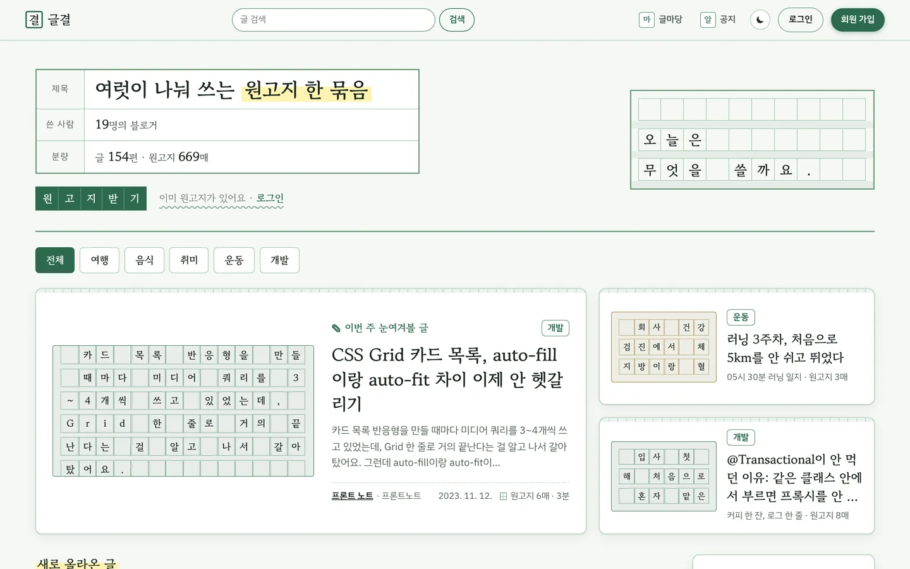</p>

## 화면 (v0.17.0)

<table>
<tr>
<td width="50%">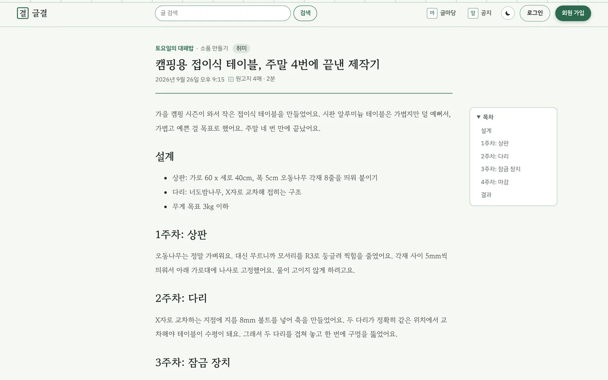<br/><b>글 읽기</b> — 목차, 원고지 매수·읽는 시간</td>
<td width="50%">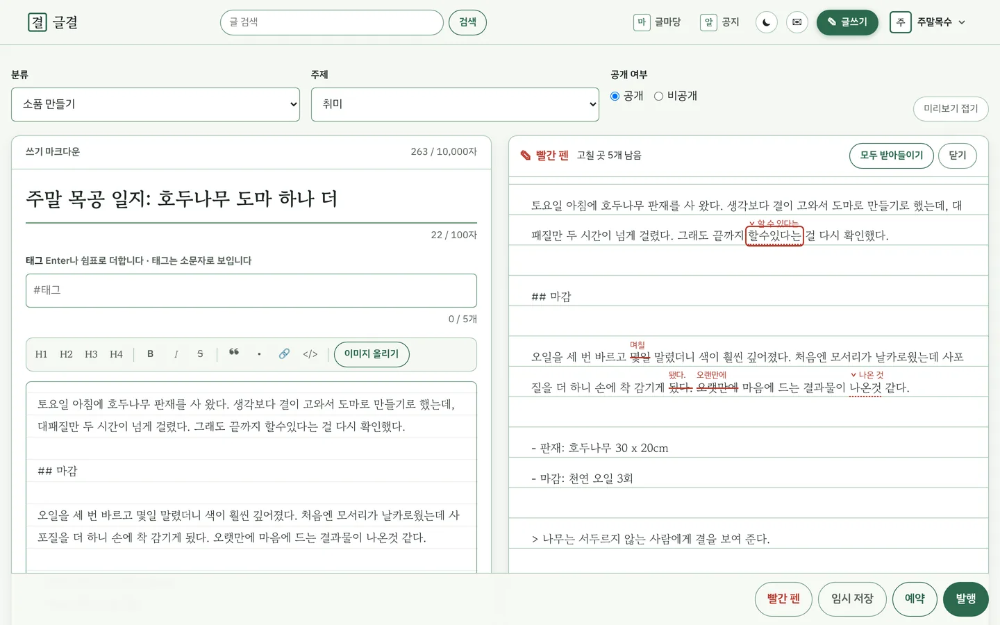<br/><b>글쓰기 + 빨간 펜</b> — 띄어쓰기·맞춤법을 교정부호로 짚고 하나씩 받아들인다</td>
</tr>
<tr>
<td width="50%">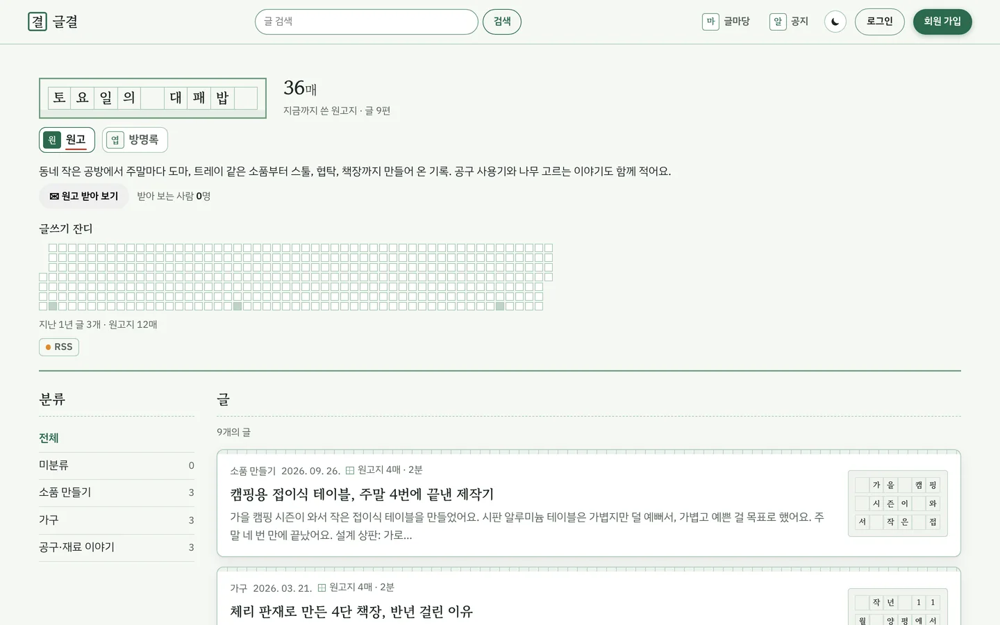<br/><b>블로그</b> — 쓴 원고지 매수, 지난 1년의 글쓰기 잔디, 원고 받아 보기·방명록</td>
<td width="50%">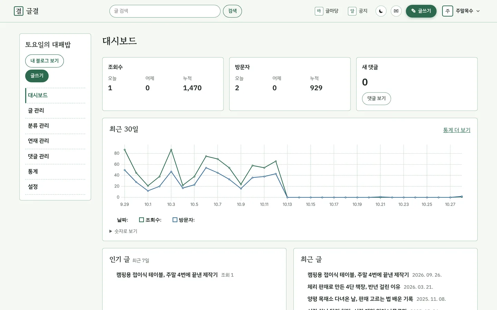<br/><b>대시보드</b> — 조회수·방문자, 최근 30일 그래프, 새 댓글</td>
</tr>
<tr>
<td width="50%">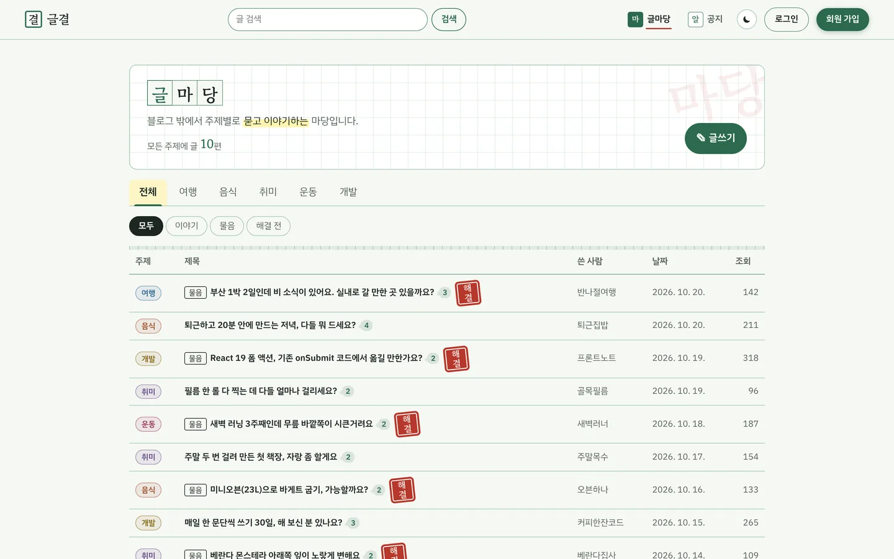<br/><b>글마당</b> — 주제별 이야기·물음, 물음에는 붉은 채택 도장</td>
<td width="50%">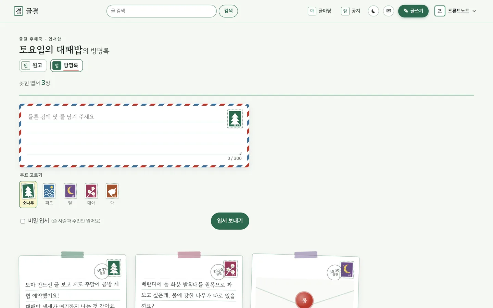<br/><b>방명록</b> — 우표를 붙인 엽서, 밀랍으로 봉한 비밀 엽서, 주인의 답장</td>
</tr>
<tr>
<td width="50%">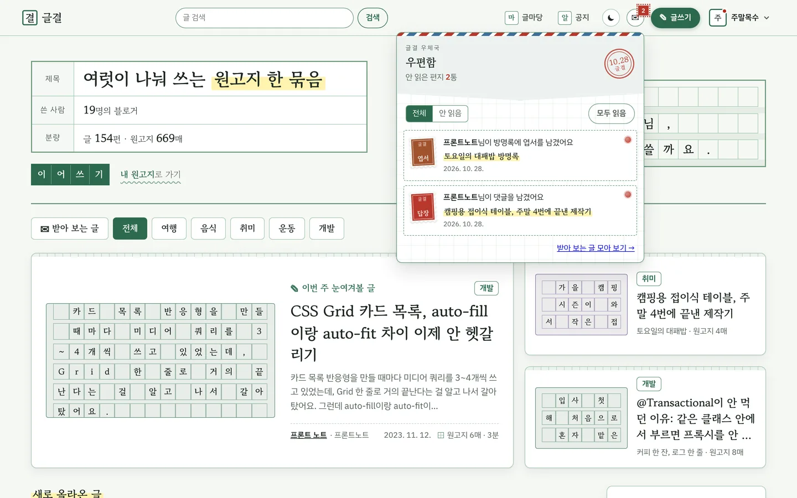<br/><b>우편함</b> — 새 원고·댓글·답글·엽서 소식을 우표 색으로, 읽으면 소인</td>
<td width="50%">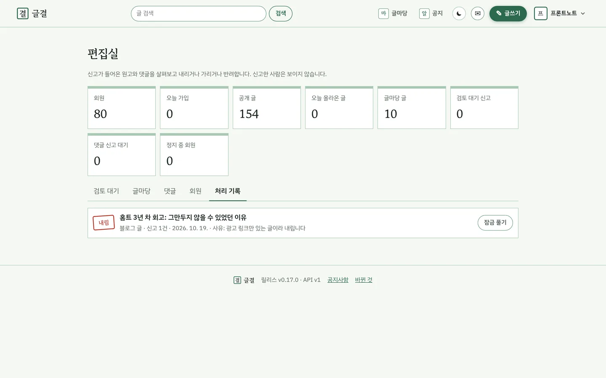<br/><b>편집실</b> — 신고 검토·내림·반려, 댓글 가림, 회원 정지, 처리 기록</td>
</tr>
<tr>
<td width="50%">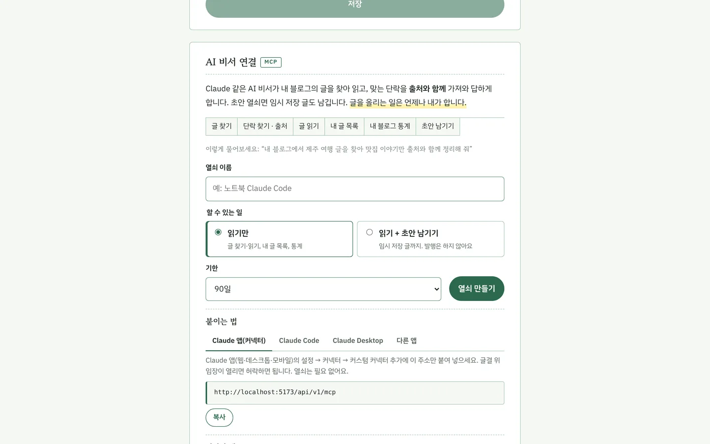<br/><b>AI 비서 연결</b> — 개인 열쇠 또는 Claude 앱 커넥터로 MCP에 붙인다</td>
<td width="50%">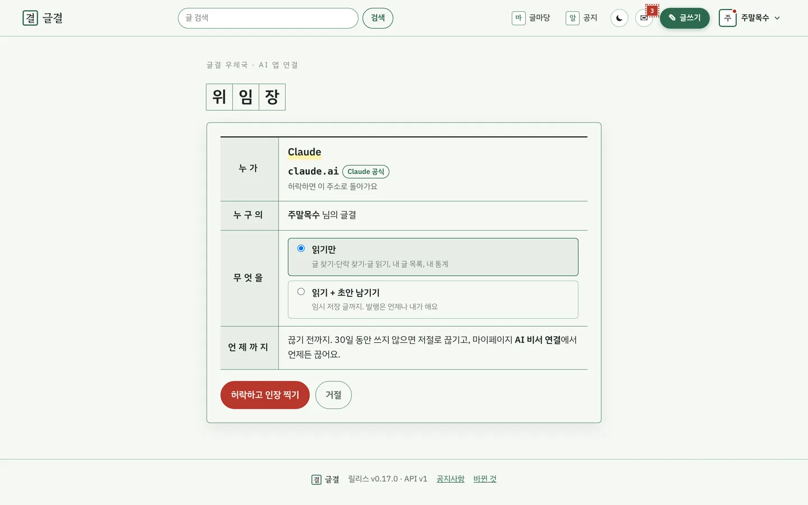<br/><b>위임장</b> — Claude 앱이 무엇을 언제까지 할 수 있는지 보고 인장을 찍어 허락</td>
</tr>
<tr>
<td width="50%">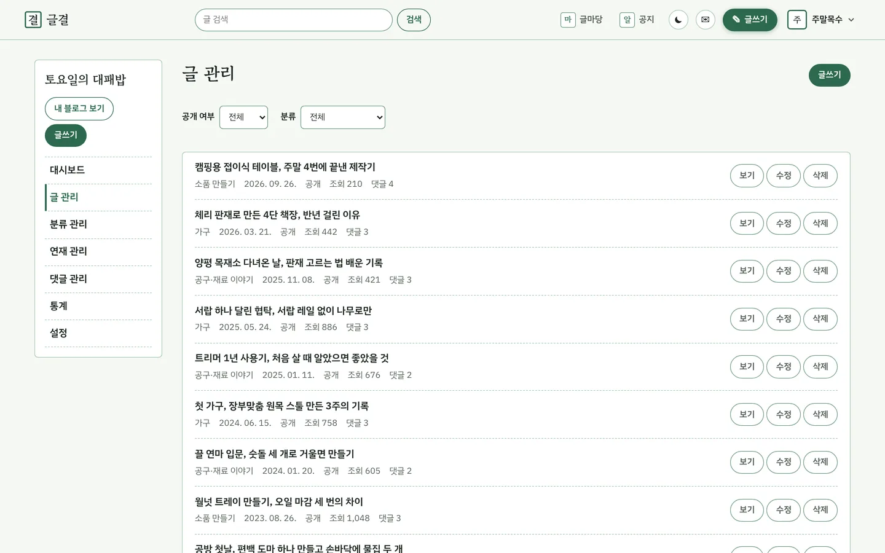<br/><b>글 관리</b> — 공개 범위, 임시 저장·예약 발행</td>
<td width="50%">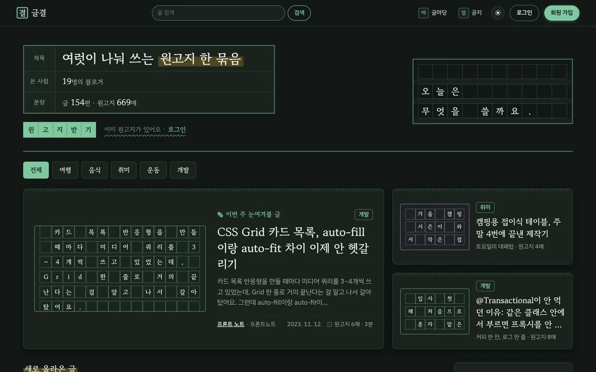<br/><b>다크 모드</b> — 원고지 색을 그대로 어둡게</td>
</tr>
</table>

## 할 수 있는 것

| 묶음 | 기능 |
|---|---|
| 회원 | 이메일 인증 가입, 로그인(5번 틀리면 잠금), 소셜 로그인(GitHub·카카오·네이버·Google), 마이페이지, 비밀번호 변경, 탈퇴 |
| 블로그와 글 | 블로그 하나씩, 분류(비공개 가능), 마크다운 글쓰기와 나란히 미리보기, 공개 범위, 태그, 이미지 |
| 글쓰기 도구 | 임시 저장(30초마다 저절로), 예약 발행, 연재(1화·2화, 이전·다음 화), 글쓰기 잔디(지난 1년) |
| 둘러보기 | 첫 화면 주제별 글 모음, 오늘의 이슈(오늘·어제 많이 읽힌 글), 이번 주 인기 글, 검색, 지금 많이 찾는 말(실시간 인기 검색어), 원고지 매수·읽는 시간 |
| 소통 | 댓글과 답글(한 단계), 봉한 쪽지(비밀 댓글), 좋아요, 신고, 문장 수집과 필사 노트(본문에서 고른 문장을 원고지 칸 카드로 모아 둠, 나만 봄) |
| 블로그 관리 | 글·댓글 관리, 대시보드, 방문자·조회수 통계 그래프 |
| 구독·알림 | 원고 받아 보기(블로그 구독, 받아 보는 글 모아 보기), 우편함(새 원고·댓글·답글 소식, 우표와 소인), 원고 편지(새 원고 메일, 그만 받기 링크) |
| 글마당 | 블로그와 따로 서는 주제별 게시판: 이야기·물음, 댓글, 물음의 채택 도장, 첫 화면 최근 글, 검색 결과 |
| 편집실 | 관리자만: 신고 검토(내림 = 비공개로 돌리고 잠금, 반려), 글마당 신고·지우기, 처리 기록·잠금 풀기, 운영 현황 숫자 |
| AI 비서 연결 (MCP) | 마이페이지에서 만든 개인 열쇠로 Claude 같은 AI 비서가 `/api/v1/mcp`에 붙어 글·단락을 출처와 함께 찾아 읽고(RAG의 찾기), 내 글 목록·통계를 보고, 초안을 남긴다(발행은 하지 않음). 답은 사용자의 AI가 써서 서버에 유료 AI 열쇠가 필요 없다 |
| 공유 | RSS, 사이트 지도, 링크 미리보기 카드(OG) |
| 공지사항 | 업데이트·공지 탭, 새 글 알림 점, 관리자만 쓰기 |
| AI | 빨간 펜 교정(원고지 위 교정부호로 짚고 받아들일지 고름. 배포에서는 Claude가 교정하고, 열쇠가 없는 개발 환경에서는 서버 안의 무료 맞춤법 규칙), 이 글과 비슷한 글(배포에서는 내 서버의 무료 Ollama + bge-m3 임베딩으로 뜻이 가까운 글, Voyage 열쇠가 있으면 Voyage, 둘 다 없으면 태그·주제로 대신) |

## 지금까지의 릴리스

| 버전 | 날짜 | 무엇이 생겼나 |
|---|---|---|
| 0.17.0 | 2026-10-20 | Claude 앱 커넥터: MCP 주소 하나로 붙는 OAuth 2.1 인가 서버와 위임장 |
| 0.16.0 | 2026-10-20 | 방명록 엽서함, 댓글 신고·자동 가림, 회원 정지 |
| 0.15.0 | 2026-10-20 | 글결 MCP: AI 비서가 내 글·단락을 출처와 함께 찾고 초안을 남김, 우편함 다시 그리기 |
| 0.14.0 | 2026-10-19 | 답글과 봉한 쪽지(비밀 댓글) |
| 0.13.0 | 2026-10-19 | 편집실: 신고 검토·내림·반려 |
| 0.12.0 | 2026-10-19 | 글마당: 주제별 이야기·물음, 채택 도장 |
| 0.11.0 | 2026-10-19 | 원고 받아 보기(구독), 우편함, 원고 편지(메일) |
| 0.10.0 | 2026-10-19 | 필사 노트, 오늘의 이슈, 지금 많이 찾는 말 |
| 0.8.0 · 0.9.0 | 2026-10-19 | 빨간 펜 교정과 이 글과 비슷한 글 |
| 0.7.0 | 2026-10-16 | 임시 저장, 예약 발행, 연재, 글쓰기 잔디 |
| 0.6.0 | 2026-10-15 | 공지사항, API 문서 |
| 0.5.x | 2026-10-13 ~ 14 | 소셜 로그인, 원고지 손길, 무중단 배포 |
| 0.1.0 ~ 0.4.0 | 2026-10-12 | 첫 배포, 다크 모드·목차·원고지 매수, 카드 썸네일, `/api/v1` |

자세한 변경(화면·API·운영)은 [CHANGELOG.md](CHANGELOG.md)에 있습니다.

## 기술

| 어디 | 무엇 |
|---|---|
| 서버 | Java 21, Spring Boot 4.1, Maven, Spring Security(세션 + CSRF), Spring Session JDBC, Spring Modulith, Flyway |
| 화면 | React 19, Vite 8, TypeScript, React Router, react-markdown, uPlot |
| AI | 규칙 교정기(서버 안, 무료), Claude API(공식 Java SDK `anthropic-java`, 구조화된 출력, 유료·선택), Ollama + bge-m3(내 서버, 무료·선택) 또는 Voyage AI 임베딩(유료·선택). 벡터는 `real[]`에 저장, 비슷한 정도는 서버가 계산 |
| 저장소 | PostgreSQL 18(pgvector 이미지), Redis 8(짧게 쓰고 버리는 값), MinIO(이미지, S3 방식) |
| 배포 | Docker 이미지 → GitHub Actions → 실습 서버. 앱 두 벌(a, b)을 Nginx `upstream`으로 번갈아 쓰고 한 벌씩 바꾸는 롤링 배포 |
| 품질 | JUnit 5 · MockMvc · Spring REST Docs, Vitest · Testing Library · MSW, JaCoCo, SonarQube, CodeRabbit |

```text
브라우저 ──▶ Nginx(학원, HTTPS) ──upstream──▶ 앱 a (화면 Nginx → 서버)   ┐
                                       └──▶ 앱 b (화면 Nginx → 서버)   ┴─▶ PostgreSQL · Redis · MinIO
```

## 폴더

| 폴더 | 내용 |
|---|---|
| `backend/` | 서버. `com.myblog` 아래 기능별 모듈: `user`(회원) ← `blog`(블로그·분류) ← `post`(글·둘러보기·공유) ← `comment`·`community`(좋아요·신고·태그·필사 노트)·`image`, `notice`(공지사항), `ai`(빨간 펜 교정), `subscription`(구독·우편함·원고 편지), `board`(글마당), `editorial`(편집실, 관리자), `connect`(AI 비서 MCP), `stats`(통계, 읽기만), `common`(보안·오류·설정). 모듈 방향은 `ModularityTest`가 지킨다 |
| `backend/src/main/resources/db/migration` | 표는 Flyway로만 만든다 |
| `backend/src/docs/asciidoc` | Spring REST Docs 원고 |
| `frontend/` | 화면. 기능별 폴더(`auth`, `post`, `explore` …), 디자인 토큰은 `src/index.css` 한곳 |
| `deploy/` | 배포 스크립트와 Nginx 견본. 방법은 [deploy/README.md](deploy/README.md) |
| `docker-compose.yml` | 개발용 PostgreSQL, Redis, MinIO |
| `docker-compose.deploy.yml` | 배포용 (앱 두 벌) |
| `.github/` | CI, 품질 분석, 배포, 예시 데이터 작업, Dependabot |
| `.run/` | IntelliJ 실행 설정 |

## 빠르게 실행하기

```bash
# 저장소 맨 위에서
cp .env.example .env                 # 처음 한 번. 접속 정보 견본 (git에 올라가지 않는다)
docker compose up -d --wait          # PostgreSQL, Redis, MinIO
cd backend && mvn spring-boot:run    # 서버 http://localhost:8080 (켜진 채로 둔다)
```

```bash
# 두 번째 터미널에서, 저장소 맨 위부터
cd frontend && npm install && npm run dev   # 화면 http://localhost:5173
```

IntelliJ에서는 오른쪽 위 실행 목록에서 `1. DB·Redis·MinIO 켜기` → `MyBlog 전체 (서버+화면)`을 고르면 됩니다. 예시 블로거 12명과 글 108개가 처음 켤 때 저절로 들어갑니다. 자세한 것과 문제 해결은 [docs/개발-환경.md](docs/개발-환경.md)에 있습니다.

## API 문서

| 문서 | 보는 법 |
|---|---|
| Swagger (API 160개 전체) | 서버를 개발 설정으로 켜고 http://localhost:8080/swagger-ui.html. 20개 묶음, 로그인·CSRF가 필요한 API에 표시 |
| Spring REST Docs (주요 흐름 32개, 실제 요청·응답) | `cd backend && mvn -Pdocs verify` → `backend/target/generated-docs/index.html` |

모든 주소는 `/api/v1/…`입니다. 로그인은 서버 세션(쿠키 `SESSION`)이고, GET이 아닌 요청은 쿠키 `XSRF-TOKEN`의 값을 머리글 `X-XSRF-TOKEN`에 실어 보냅니다.

## 테스트

```bash
# 저장소 맨 위에서. 괄호는 그 폴더에 들어갔다가 돌아온다
(cd backend && mvn verify)                  # 서버 테스트 960여 개 + JaCoCo 커버리지 (DB·Redis가 떠 있어야 한다)
(cd frontend && npm test)                   # 화면 테스트 (Vitest)
(cd frontend && npm run test:coverage)      # 화면 커버리지 (coverage/lcov.info)
```

기능마다 정상값·경계값·예외값을 함께 테스트하고, 테스트가 실패하면 테스트가 아니라 구현을 고칩니다. 기준은 문서 저장소의 [테스트 전략](https://github.com/home-blog/docs/blob/main/docs/3-설계/테스트-전략.md)에 있습니다.

## 작업 방식

- **Git Flow**로 일합니다. `main`과 `develop`에는 직접 올리지 않고 모두 PR로 합칩니다.

  | 브랜치 | 어디서 만들어 | 어디로 합치나 | 하는 일 |
  |---|---|---|---|
  | `main` | — | — | 배포된 코드. 릴리스마다 태그 `v<번호>` |
  | `develop` | `main` | — | 다음 릴리스를 모으는 곳 (기본 브랜치) |
  | `feature/<내용>` | `develop` | `develop` | 기능 하나 |
  | `release/<번호>` | `develop` | `main`, 그다음 `develop` | 릴리스 준비: CHANGELOG 날짜, 마지막 확인. 합치면 배포 |
  | `hotfix/<번호>` | `main` | `main`, 그다음 `develop` | 서비스가 멈추는 급한 버그만 |

  ```text
  feature/* ──PR──▶ develop ──release/0.5.0──PR──▶ main ──▶ Actions 배포(0.5.0) → 태그 v0.5.0
                       ▲                                 │
                       └─────────── main을 다시 합침 ◀────┘   (hotfix/*도 main → develop 순서)
  ```
- PR마다 자동 검사가 돕니다: **CI**(서버 빌드·테스트, 화면 린트·테스트·빌드), **SonarQube**(품질·커버리지, Quality Gate를 통과해야 초록), **CodeRabbit**(1차 코드 리뷰, 한국어). 모두 통과해야 merge합니다. 문서(`*.md`, `docs/`, `specs/`)만 바꾼 PR은 CI가 돌지 않으므로 CodeRabbit 리뷰만 보고 합칩니다.
- **번호**: 새로 할 수 있는 게 생기면 가운데 숫자(0.6.0), 고치기·다듬기·운영 개선은 끝 숫자(0.5.3). 다음 릴리스의 변경은 PR마다 CHANGELOG의 `준비 중` 절에 쌓습니다. API 주소 버전(`/api/v1`)은 릴리스 번호와 따로 가고, 깨지는 변경일 때만 `v2`를 엽니다.
- **배포**는 릴리스를 낼 때만 합니다. Actions `배포`를 `main`으로 손 실행하며 번호를 넣으면, 확인 → 롤링 배포 → 태그와 GitHub 릴리스까지 만듭니다.
- 무엇을 만들지는 문서 저장소의 `specs/<기능>/tasks.md`, 어떻게는 같은 폴더의 `plan.md`, `contracts/`를 따릅니다.
- 비밀번호, 키 같은 비밀 값은 코드와 설정 파일에 넣지 않습니다. 로컬은 `.env`(git 제외), 배포는 GitHub Secrets로 넣습니다. `.env.example`의 값은 개발 전용입니다.
